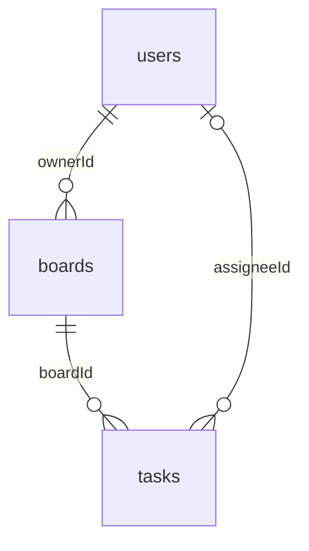

# TaskBoard

Aplikacja do zarządzania zadaniami zespołu: tablice, zadania w trzech statusach, rejestracja i logowanie. Backend: Node.js, Express, MySQL/MariaDB. Frontend: HTML, Bootstrap 5.3 i JavaScript.

## Struktura projektu

| Ścieżka | Zawartość |
|---|---|
| `backend/server.js` | Start serwera, sesja, podłączenie tras i plików z `frontend/` |
| `backend/db.js` | Połączenie z bazą (dane z `.env`) |
| `backend/routes/` | Trasy API: `auth.js`, `boards.js`, `tasks.js`, `users.js` |
| `backend/middleware/auth.js` | `requireAuth`: odpowiedź 401 bez zalogowania |
| `frontend/` | Widoki `login.html`, `boards.html`, `board.html`, styl `css/style.css`, skrypty w `js/` |
| `database/taskboard.sql` | Skrypt odtwarzający całą bazę od zera (struktura i dane testowe) |
| `database/konta.sql` | Konta bazy i uprawnienia |
| `database/queries.sql` | Zapytania SQL z komentarzami |
| `database/backup/` | Kopie zapasowe bazy (`taskboard_RRRR-MM-DD.sql`) |
| `docs/zadania/` | Treść zadań TB-1, TB-2, TB-3 |
| `docs/postman/` | Kolekcja Postman (testy API) |
| `docs/testy.md` | Przypadki testowe (API i interfejs) |
| `docs/dane.md` | Opis danych zgodny ze schematem bazy |
| `.env.example` | Wzór pliku `.env` |

## Uruchomienie

Wymagania: Node.js, XAMPP (MySQL/MariaDB) albo inny serwer MySQL.

1. Pobierz projekt i wejdź do folderu: `git clone <adres-repozytorium>`, `cd taskboard-Denys-Petrow`.
2. Uruchom MySQL (w XAMPP: Start przy MySQL).
3. Odtwórz bazę i konta (w CMD, nie w PowerShellu; można też użyć phpMyAdmin → Import):
   ```
   C:\xampp\mysql\bin\mysql.exe -u root < database\taskboard.sql
   C:\xampp\mysql\bin\mysql.exe -u root < database\konta.sql
   ```
4. Utwórz plik `.env` w głównym folderze projektu na podstawie wzoru:
   ```
   copy .env.example .env
   ```
   W `.env` jest konto `taskboard_app` (`DB_USER`, `DB_PASSWORD`, `DB_HOST=127.0.0.1`) oraz `SESSION_SECRET`. Zmień `SESSION_SECRET` na własny długi, losowy tekst.
5. Zainstaluj zależności i uruchom serwer:
   ```
   cd backend
   npm install
   npm start
   ```
6. Otwórz `http://localhost:3000`. Konta testowe z bazy, np. `anna.nowak` z hasłem `Test1234!`, albo załóż własne na zakładce „Rejestracja”.

## API

Wszystkie trasy poza `/api/auth/*` i `/api/health` wymagają zalogowania (inaczej 401).

| Trasa | Działanie |
|---|---|
| `POST /api/auth/register`, `POST /api/auth/login` | Rejestracja i logowanie (sesja w ciasteczku) |
| `POST /api/auth/logout`, `GET /api/auth/me` | Wylogowanie, dane zalogowanej osoby |
| `GET/POST /api/boards`, `PUT/DELETE /api/boards/:id` | Tablice (usuwanie miękkie) |
| `GET /api/boards/:boardId/tasks` | Zadania tablicy, filtry `priority`, `assigneeId`, `q` |
| `GET /api/tasks/:id`, `POST /api/tasks`, `PUT/DELETE /api/tasks/:id` | Zadania (usuwanie miękkie) |
| `GET /api/users` | Lista osób bez `passwordHash` |

## Baza danych

Baza `taskboard` (MariaDB/MySQL, InnoDB, `utf8mb4`, `utf8mb4_polish_ci`). Pełny opis pól: `docs/dane.md`.

### Tabele i relacje

| Tabela | Najważniejsze kolumny | Opis |
|---|---|---|
| `users` | `id`, `login` (unikalny), `passwordHash`, `firstName`, `lastName`, `createdAt` | Osoby korzystające z aplikacji |
| `boards` | `id`, `name`, `description`, `ownerId`, `createdAt`, `isDeleted`, `deletedAt`, `deletedById` | Tablice zadań |
| `tasks` | `id`, `title`, `description`, `status`, `priority`, `deadline`, `boardId`, `assigneeId`, `createdAt`, `isDeleted`, `deletedAt`, `deletedById` | Zadania na tablicach |

- `boards.ownerId` → `users.id`: użytkownik jest właścicielem wielu tablic.
- `tasks.boardId` → `boards.id` (`ON DELETE CASCADE`): tablica ma wiele zadań.
- `tasks.assigneeId` → `users.id` (`ON DELETE SET NULL`): zadanie ma jedną osobę odpowiedzialną albo żadnej.
- `boards.deletedById` i `tasks.deletedById` → `users.id`: kto usunął rekord.



### Soft delete

Rekordy tablic i zadań nie są kasowane. Usunięcie ustawia razem `isDeleted = 1`, `deletedAt = NOW()` i `deletedById` (id zalogowanej osoby z sesji). Zapytania aplikacji filtrują `isDeleted = 0`, więc usunięty rekord znika z API (404), ale zostaje w bazie:

```sql
SELECT id, title, isDeleted, deletedAt, deletedById FROM tasks WHERE isDeleted = 1;
```

### Konta bazy

`database/konta.sql` tworzy trzy konta (każde dla `localhost` i `127.0.0.1`):

| Konto | Uprawnienia | Do czego służy |
|---|---|---|
| `taskboard_app` | `SELECT`, `INSERT`, `UPDATE` | Aplikacja (API); usuwa miękko, więc bez `DELETE` |
| `taskboard_admin` | także `DELETE` | Czyszczenie starych wpisów |
| `taskboard_report` | tylko `SELECT` | Raporty i podgląd |

Aplikacja łączy się kontem `taskboard_app` (nie `root`).

### Odtworzenie bazy

`database/taskboard.sql` zaczyna się od `DROP DATABASE IF EXISTS taskboard`, więc odtwarza bazę od zera (patrz krok 3 w „Uruchomieniu”). Konta tworzy `database/konta.sql`.

### Kopia zapasowa i jej sprawdzenie

1. Utworzenie kopii z datą w nazwie (w CMD):
   ```
   C:\xampp\mysql\bin\mysqldump.exe -u root --result-file=database\backup\taskboard_RRRR-MM-DD.sql taskboard
   ```
2. Utwórz pustą bazę testową i odtwórz w niej kopię:
   ```
   C:\xampp\mysql\bin\mysql.exe -u root -e "CREATE DATABASE taskboard_test CHARACTER SET utf8mb4 COLLATE utf8mb4_polish_ci"
   C:\xampp\mysql\bin\mysql.exe -u root taskboard_test < database\backup\taskboard_RRRR-MM-DD.sql
   ```
3. Porównaj liczbę rekordów w obu bazach (`taskboard` i `taskboard_test`):
   ```sql
   SELECT COUNT(*) FROM users;
   SELECT COUNT(*) FROM boards;
   SELECT COUNT(*) FROM tasks;
   SELECT COUNT(*) FROM tasks WHERE isDeleted = 1;
   ```

Wynik sprawdzenia: taskboard i taskboard_test, users: 6 / 6, boards: 3 / 3, tasks: 15 / 15, usunięte zadania: 7 / 7.

## Testy

Przypadki testowe: `docs/testy.md`. Testy API: kolekcja Postman z `docs/postman/` (najpierw uruchom całą kolekcję w Collection Runnerze: zaczyna się od wylogowania i logowania).
