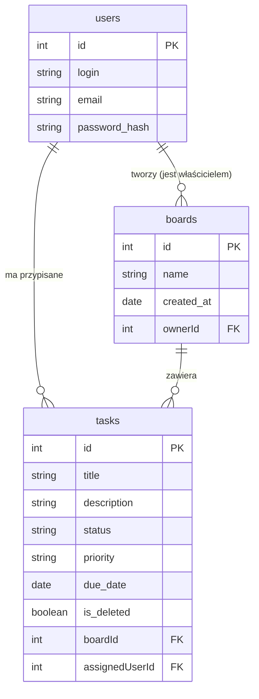

# Opis danych i wstępny diagram ERD

## 1. Opis encji (danych)

### Użytkownik (users)
Przechowuje dane potrzebne do identyfikacji i autoryzacji osób korzystających z aplikacji. Hasło ze względów bezpieczeństwa musi być przechowywane w formie zaszyfrowanej (hasz).

| Informacja | Przykład |
| --- | --- |
| ID (Klucz główny) | 1 |
| Login | denys_petrow |
| Adres e-mail | denys.petrow@example.com |
| Hasło (zahaszowane) | $2a$12$R9h/cIPz96n.. |

### Tablica (boards)
Reprezentuje przestrzeń roboczą (projekt), w ramach której tworzone są zadania. Każda tablica ma swojego właściciela.

| Informacja | Przykład |
| --- | --- |
| ID (Klucz główny) | 10 |
| Nazwa tablicy | Projekt Praktyki INF.03 |
| Data utworzenia | 2026-11-04 |
| ID Właściciela | 1 |

### Zadanie (tasks)
Reprezentuje konkretną pozycję do wykonania na tablicy. Zawiera informacje o stanie, priorytecie oraz opcjonalnym terminie i osobie przypisanej. Usunięcie zadania w demo nie usuwa go fizycznie z bazy, lecz oznacza flagą jako usunięte logicznie (soft delete).

| Informacja | Przykład |
| --- | --- |
| ID (Klucz główny) | 101 |
| Tytuł | Uzupełnić README |
| Opis | Dodać opis instalacji i uruchomienia |
| Status | IN_PROGRESS (w toku) |
| Priorytet | HIGH (wysoki) |
| Termin wykonania | 2026-11-06 (opcjonalnie) |
| Czy usunięte | false |
| ID Tablicy | 10 |
| ID Przypisanej osoby | 1 (opcjonalnie) |

---

## 2. Powiązania między danymi
Jeden użytkownik może utworzyć wiele niezależnych tablic, stając się ich właścicielem, natomiast każda tablica musi mieć przypisanego dokładnie jednego właściciela. Każda tablica z kolei zawiera w sobie wiele zadań, ale jedno konkretne zadanie może należeć tylko i wyłącznie do jednej wybranej tablicy. Dodatkowo, zadanie może (ale nie musi) mieć przypisanego jednego użytkownika, który jest odpowiedzialny za jego realizację, podczas gdy jeden użytkownik może mieć przypisanych wiele zadań na raz.

---

## 3. Przykład zadania w formacie JSON

```json
{
  "id": 101,
  "title": "Uzupełnić README",
  "description": "Dodać opis instalacji i uruchomienia",
  "status": "IN_PROGRESS",
  "priority": "HIGH",
  "dueDate": "2026-11-06",
  "isDeleted": false,
  "boardId": 10,
  "assignedUserId": 1
}
```

---

## 4. Wstępny diagram ERD


